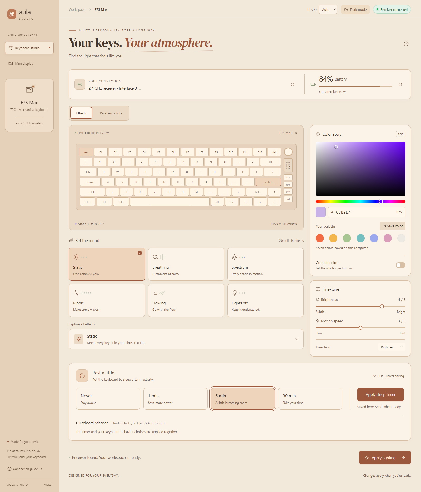
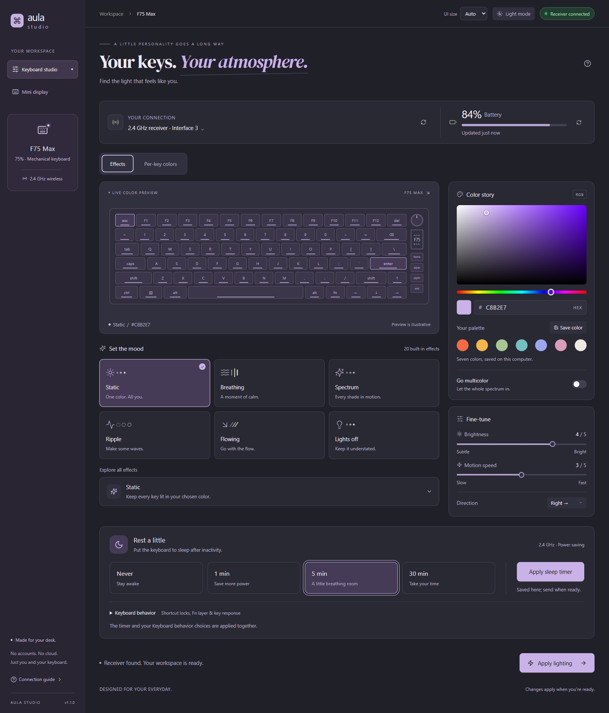
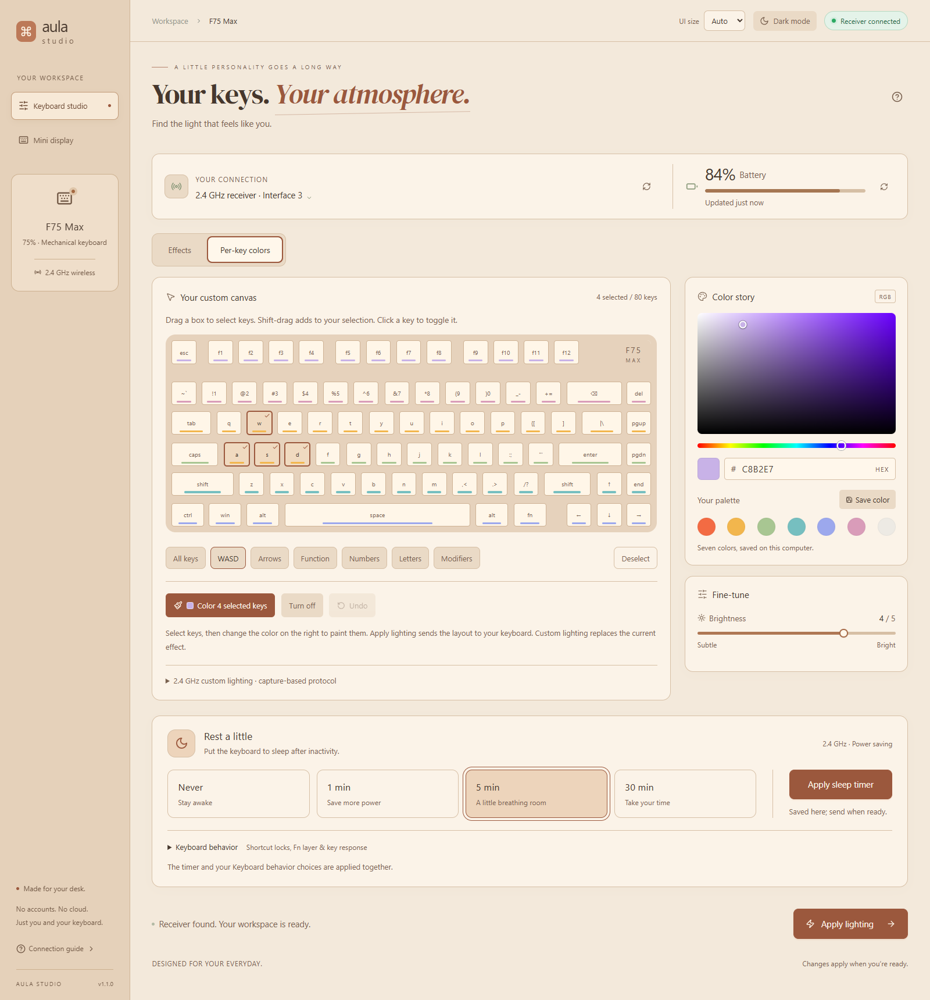
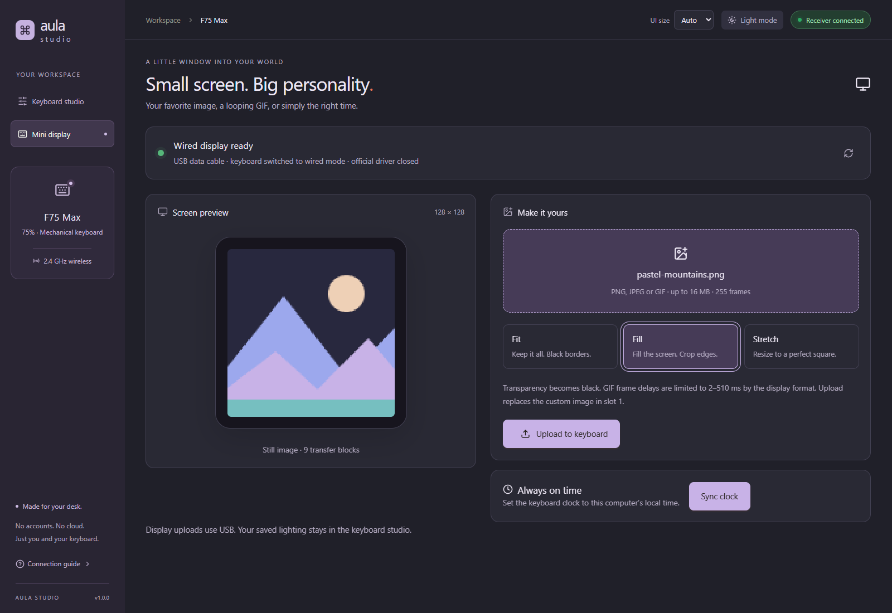
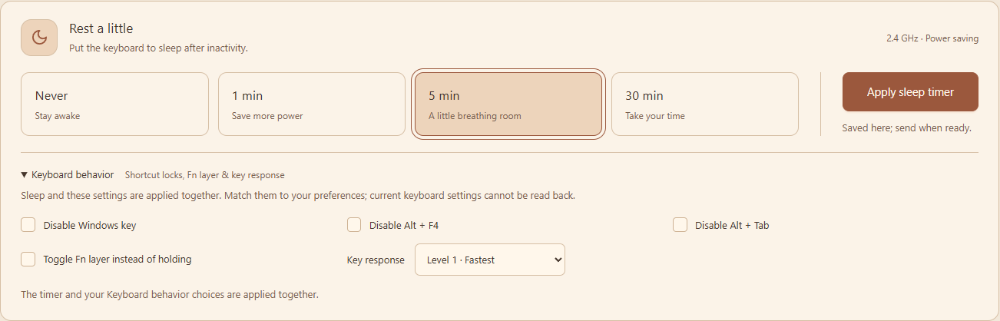

# AULA Studio

A small desktop app for the **AULA F75 Max**. Change RGB effects, paint individual keys, check battery percentage, and put an image or GIF on the keyboard’s mini display.

The app uses a native window on Windows, Apple Silicon macOS and Linux, built with Tauri, React and Rust. Normal use needs no external browser, Python installation or separately installed Node runtime.

[Download releases](https://github.com/diamachi/aula-studio/releases) · [Build and development guide](docs/DEVELOPMENT.md) · [Release guide](docs/PUBLISHING.md)

> Unofficial project, not affiliated with AULA or EPOMAKER. Desktop packages are unsigned. AULA Studio runs locally; no account or cloud service is needed.

## A look at the app

Screenshots below show the actual interface in an isolated preview with example connection and battery data. Hardware access was disabled during capture.

### Connection, battery and lighting

The top panel shows the selected receiver interface and keyboard-reported battery percentage. A green connection badge means the USB receiver is present; it does not confirm that the wireless keyboard is awake. Receiver checks run every five seconds, with battery refresh every 30 seconds while the app is visible or when requested manually.

Choose an effect card or explore all **20 effects** in the effect chooser. Use the color area, hue slider, system picker or hex input, then adjust brightness, speed and direction. Click **Apply lighting** to send the settings.

<table>
  <tr><th>Warm light</th><th>Charcoal dark</th></tr>
  <tr>
    <td width="50%"></td>
    <td width="50%"></td>
  </tr>
</table>

### Per-key colors

Open **Per-key colors** to paint individual keys or groups. Drag a rectangle across the keyboard to select several keys; hold **Shift, Ctrl or Command** while dragging to add to the selection. Group shortcuts, turn-off and undo controls make larger layouts easier to edit.

Picking a color paints the selected keys in the editor. **Apply lighting** sends the layout to the keyboard. The outlined tab shows which editor is active. To return to ordinary lighting, switch to **Effects** and apply an effect.



### Mini display and clock

Connect a USB data cable, switch the keyboard to **wired mode**, and open **Mini display**. Choose a PNG, JPEG or GIF, select **Fit**, **Fill** or **Stretch**, review the 128 × 128 preview, then click **Upload to keyboard**. GIF previews show the first frame; the complete animation is uploaded. Keep USB connected until the upload finishes.

Uploads replace custom image slot 1. Select the custom-image screen using the keyboard controls if needed. **Sync clock** sets the keyboard to this computer’s local time.

**Image/GIF uploads require wired USB.** No working upload route was found over the 2.4 GHz receiver; see the [wireless display investigation](research/wireless-display-audit.md).



### Sleep timer

Under **Rest a little**, choose Never, 1 min, 5 min or 30 min, then click **Apply sleep timer**. The receiver must be connected in 2.4G mode. No sleep setting is sent automatically on startup.

Expand **Keyboard behavior** to choose shortcut locks, Fn behavior and response level. The keyboard applies these settings together with sleep; the app cannot read the existing values back. Saved choices are local preferences. Receiver acknowledgments confirm receipt; physical sleep timing still needs testing.



### Appearance and saved colors

Choose warm oat-and-apricot light mode with a matching sand sidebar, or charcoal dark mode. Locally bundled DM Serif Display headings pair roman and italic lettering. The interface scales with the window, with a saved **UI size** override: Auto, 100%, 125% or 150%.

All seven palette slots are editable. Pick a color, click **Save color**, then choose the slot to replace. Theme, palette, lighting settings and the per-key layout are saved locally. The native title bar follows the app’s light/dark mode; Windows 11 also receives matching cream/charcoal caption colors.

## What it does

| Feature | Behavior |
| --- | --- |
| RGB effects | 20 modes, single color or multicolor, brightness, motion speed and direction over 2.4 GHz. |
| Per-key lighting | Individual keys, rectangle selection, additive selection, groups, painting, lights off and undo. |
| Battery | Reads the keyboard-reported percentage through the receiver, with automatic and manual refresh. |
| Mini display | Wired PNG/JPEG/GIF upload to the 128 × 128 screen, with resizing choices and transfer progress. |
| Image limits | Up to 16 MB, 4096 × 4096 source pixels and 255 frames. Transparency becomes black; GIF delays are limited to 2–510 ms per frame. |
| Clock | Syncs the keyboard clock over wired USB. |
| Keyboard sleep | Never, 1 minute, 5 minutes or 30 minutes over the 2.4 GHz receiver; explicit Apply with companion keyboard-behavior controls. |
| Appearance | Light/dark themes, responsive sizing and seven editable color presets. |
| Local preferences | Saves editor settings on this computer; no account or cloud storage. |

Lighting selections and the keyboard illustration are **editor preferences and previews, not live device readback**. Battery is read from the keyboard. Key remapping, Bluetooth configuration and firmware updates are not implemented.

## Install

- **Windows x64:** download the setup EXE from [Releases](https://github.com/diamachi/aula-studio/releases), or use `AULA-Studio-Windows-x64.exe` for the portable app. Microsoft WebView2 is required.
- **Mac, Apple Silicon / M-series:** open the release `aarch64.dmg`, drag **AULA Studio** into Applications, and open it. The app is not notarized. If macOS blocks the unsigned app, run `xattr -dr com.apple.quarantine /Applications/AULA\ Studio.app` in Terminal and open it again. When the USB receiver is connected, AULA Studio requests Input Monitoring access if needed; approve the macOS prompt. If access was already denied, enable AULA Studio under **System Settings → Privacy & Security → Input Monitoring**, then quit and reopen it.
- **Linux x64:** download the `.AppImage` from [Releases](https://github.com/diamachi/aula-studio/releases), make it executable with `chmod +x ./*.AppImage`, then run it with `./*.AppImage`. The desktop needs WebKitGTK 4.1 and FUSE 2 for AppImage mounting. To access the keyboard without root, install `src-tauri/linux/99-aula-studio.rules` under `/etc/udev/rules.d/`, reload udev rules and reconnect the keyboard. The rule grants the active desktop user access to the F75 Max receiver and wired display endpoints.

For lighting and battery, plug in the USB receiver, switch the keyboard to **2.4G**, and press a key to wake it. Close the official driver and other configuration apps before connecting. For the display and clock, use a USB data cable and select **wired mode**.

| Connection | Available features |
| --- | --- |
| 2.4 GHz USB receiver | RGB effects, per-key colors and battery percentage. |
| USB data cable, wired mode | Image/GIF display uploads and clock sync. |
| Bluetooth | Configuration is not supported. |

Lighting, per-key colors, battery and image/GIF playback have been checked on a physical F75 Max on Windows. On Apple Silicon macOS, receiver interface detection and battery access have also been confirmed. Clock commands were acknowledged by the keyboard. Linux packaging is provided, but Linux hardware access has not been physically verified. Intel Mac and other keyboard models and firmware batches are not verified.

## Build from source

The repository and source ZIP include dependency lockfiles, icons, platform setup/build scripts and protocol notes. **Toolchains and dependency caches are not bundled.** Initial setup needs internet access; the official vendor executable is not a build dependency.

| Target | Required tools |
| --- | --- |
| Frontend development | Node.js 22+ and npm. |
| Windows desktop | Windows x64, Rust stable, Microsoft C++ Build Tools and WebView2. |
| Mac desktop / DMG | Apple Silicon Mac, Rust stable and Xcode command line tools. |
| Linux desktop / AppImage | Linux x64, Rust stable, WebKitGTK 4.1 and the Tauri Linux prerequisites listed below. |

See the [Tauri platform prerequisites](https://v2.tauri.app/start/prerequisites/) and the [development guide](docs/DEVELOPMENT.md) for setup scripts, portable-tool behavior, tests and output locations.

```sh
npm ci
npm run desktop
```

Build each native package on its target OS. The Mac does not cross-compile Linux or Windows packages. The release workflow builds Windows x64, Apple Silicon macOS and Linux x64.

### Continue development on Linux

On Ubuntu 22.04 or a compatible distribution, install the [Tauri Linux prerequisites](https://v2.tauri.app/start/prerequisites/) and Rust stable. For Ubuntu/Debian:

```sh
sudo apt update
sudo apt install build-essential curl file libayatana-appindicator3-dev libfuse2 libssl-dev libudev-dev librsvg2-dev libwebkit2gtk-4.1-dev libxdo-dev wget
```

Then clone the repository, or unpack `AULA-Studio-source.zip`:

```sh
git clone https://github.com/diamachi/aula-studio.git
cd aula-studio
npm ci
npm run desktop
```

To build an AppImage, run `npm run test:ui`, `cargo test --locked --manifest-path src-tauri/Cargo.toml`, then:

```sh
npm run tauri -- build --bundles appimage
```

The AppImage is under `src-tauri/target/release/bundle/appimage/`. Install the included udev rule from `src-tauri/linux/99-aula-studio.rules` to use the F75 Max without running the app as root. Linux HID behavior still needs testing on a physical keyboard.

### Continue development on your Mac

Use an **Apple Silicon / M-series Mac**. Install Git, Node.js 22+ with npm, [Rust stable](https://rustup.rs/) and Apple command line tools (`xcode-select --install`). These are development prerequisites; end users only need the packaged app.

Clone the repository, or unpack `AULA-Studio-source.zip`, then open that folder in your editor:

```sh
git clone https://github.com/diamachi/aula-studio.git
cd aula-studio
sh scripts/setup-macos.sh
npm run desktop
```

Edit React/TypeScript and CSS in `src/`; edit native commands and packet handling in `src-tauri/src/`. The development window reloads frontend edits; native changes rebuild the Rust backend. The bundled fonts work offline. No Windows paths or local `.tools` folder are required on the Mac.

```sh
# Verify changes without sending hardware commands.
npm run test:ui
cargo test --locked --manifest-path src-tauri/Cargo.toml

# Build the native M-series app and DMG on your Mac.
sh scripts/build-macos.sh
```

Find the app and DMG under `src-tauri/target/release/bundle/`. Hardware access must be tested on the Mac itself; grant Input Monitoring permission if access is denied. The browser-only preview cannot configure the keyboard.

### Continue development on Windows

Use **Windows x64**, Git, Node.js 22+ with npm, Rust stable with the MSVC toolchain, Microsoft C++ Build Tools with the Desktop development with C++ workload/Windows SDK, and WebView2. Run from PowerShell:

```powershell
git clone https://github.com/diamachi/aula-studio.git
cd aula-studio
powershell -File scripts/setup-windows.ps1
npm run desktop
```

If build tools are missing, the setup script can request their installation with `-InstallTools`; reopen PowerShell afterwards and run setup again. A source ZIP also works: unpack it and run the commands from its root, skipping `git clone` and `cd`.

```powershell
npm run test:ui
cargo test --locked --manifest-path src-tauri/Cargo.toml

# Portable executable plus license notices in dist/.
powershell -File scripts/build-windows.ps1

# NSIS installer under src-tauri/target/release/bundle/nsis/.
npm run tauri -- build --bundles nsis
```

On either machine, use `git pull` before resuming work on a clean checkout and commit/push source changes to move between computers. Keep local edits committed before switching. Do not copy `node_modules`, `.tools`, `web-dist` or `src-tauri/target` between operating systems; setup recreates dependencies and build outputs for the current platform. Keep USB captures and private research files out of commits. See [development details](docs/DEVELOPMENT.md) for tool checks and source packaging.

### GitHub Actions

**Actions → Desktop builds → Run workflow** builds Windows x64, Apple Silicon macOS and Linux x64, then saves downloadable artifacts. Pushing a `v*` tag also publishes release assets after all three platform builds succeed. Normal pushes to `main` do not trigger release builds.

The release includes Windows setup and portable executables, an M-series Mac DMG, a Linux AppImage and a source ZIP. See the [release guide](docs/PUBLISHING.md).

## Project layout

```text
src/             React interface, keyboard editor and display controls
src-tauri/src/   Rust HID transport, packet encoding and image conversion
scripts/         Platform setup, build, source packaging and UI checks
docs/            Development, release and USB recording guides
research/        Protocol evidence, compatibility limits and upstream licenses
.github/         Windows, Apple Silicon and Linux build/release workflow
.tools/          Local tools and research inputs (ignored)
web-dist/        Generated frontend output (ignored)
dist/            Generated distribution files (ignored)
```

## Protocol and validation

The tested receiver is **05AC:024F**, usage page **FF60**, using its 32-byte report interface (interface 3 on Windows). Its separate 64-byte interface is excluded from wireless configuration. The wired display uses **0C45:800A**, command page **FF13** and display page **FF68**. Device IDs alone do not establish compatibility with other models.

The backend serializes HID operations, validates settings and waits for acknowledgments during custom lighting and display transfers. A failed custom-lighting transfer attempts to restore a built-in effect. No firmware flashing commands are used.

Fifteen Rust tests cover packet encoding, acknowledgment handling, image conversion, GIF timing, frame limits and clock validation. Production-DOM UI checks cover selection/apply behavior, palette and interface-size persistence, connection/battery status, display navigation and clock invocation. Passing CI verifies the software checks; physical hardware testing is listed separately above.

- [Per-key protocol and layout provenance](research/per-key-provenance.md)
- [Wired display protocol](research/display-protocol.md)
- [Wireless display investigation](research/wireless-display-audit.md)
- [Record official-app USB traffic](docs/CAPTURE-USB.md)

USB captures can contain keystrokes and unrelated device traffic. Keep raw captures private; do not attach them to public issues. This repository includes protocol facts and synthetic regression vectors, not private captures or vendor binaries.

## Size and licensing

Tauri uses the operating system’s WebView2/WebKit engine with a Rust backend. It does not bundle Chromium, Electron, Node or Python into the desktop app.

Original source is [MIT licensed](LICENSE). The bundled DM Serif Display fonts are licensed under the [SIL Open Font License](src/assets/fonts/OFL-DMSerifDisplay.txt). Wireless RGB/battery and wired display work build on [VitalyArt/Aula-F75-Max-Driver](https://github.com/VitalyArt/Aula-F75-Max-Driver); wireless per-key framing builds on [thibaultmiclo/aula-driver](https://github.com/thibaultmiclo/aula-driver). Key geometry and LED indices follow the official F75 Max layout, as described in the provenance notes. Retain [the upstream notice](research/LICENSE.upstream) and [per-key notice](research/LICENSE.perkey) when redistributing derived code. Vendor executable, firmware and artwork are not distributed.
